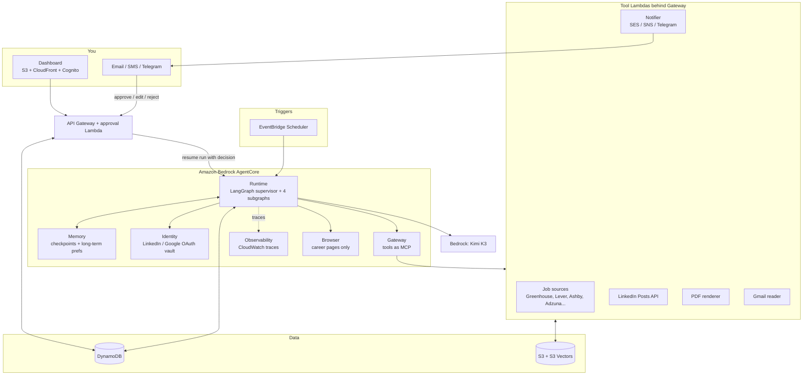
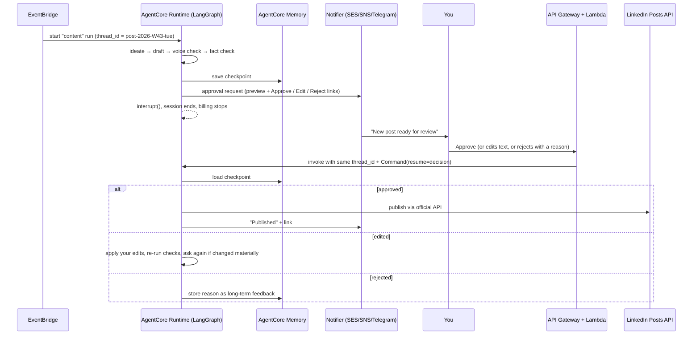

# Serverless Architecture on Amazon Bedrock AgentCore

This document replaces the self-hosted Docker/VM architecture in [PROJECT_PLAN.md](PROJECT_PLAN.md). The agent logic (LangGraph graphs, strategy, compliance rules) is unchanged; what changes is where it runs and how approvals work.

Goals for this version:

- **Fully serverless**: no servers, containers to patch, or databases to manage. Everything scales to zero and is billed per use.
- **Complete human in the loop**: every agent stops before any outward action (posting, applying, sending a connection note, emailing anyone but you), notifies you, and waits for approve, edit or reject.
- **AgentCore for the agent platform**: Runtime, Memory, Identity, Gateway, Observability, and Browser where it is safe to use.

---

## 1. Service map

| Need | AWS service | What it does here |
|---|---|---|
| Run the LangGraph agents | **AgentCore Runtime** | Hosts the LangGraph app as a serverless agent. Each run gets an isolated session; billed only while it is working. Supports runs of up to 8 hours |
| Agent memory | **AgentCore Memory** | Short-term memory = LangGraph checkpoints (via `langgraph-checkpoint-aws`), so a run paused for approval resumes exactly where it stopped. Long-term memory = your preferences, writing voice, and what you approved, rejected or edited, so drafts improve over time |
| OAuth to LinkedIn, Gmail, job APIs | **AgentCore Identity** | Token vault for your LinkedIn and Google OAuth tokens (3-legged OAuth on your behalf) and API keys; the agent never sees raw secrets in code |
| Tools as MCP | **AgentCore Gateway** | Wraps the job-source APIs, LinkedIn Posts API, PDF renderer and notification Lambdas as MCP tools the agents call, with one auth layer |
| Tracing, metrics, logs | **AgentCore Observability** | OpenTelemetry traces of every graph step and model call into CloudWatch (GenAI observability dashboard): latency, tokens, errors, per-session view |
| Browser (optional) | **AgentCore Browser** | Managed headless browser to read company career pages that have no API. Not used for LinkedIn or job-board automation (see section 6) |
| Guardrails on actions (optional) | **AgentCore Policy** (check availability in your region) | Rules such as "LinkedIn publish tool may only be called with an approval token" enforced outside the model |
| Models | **Amazon Bedrock** (Kimi K3) | Moonshot AI's Kimi K3 for all drafting, scoring and fact checks, called through the Converse API with the US cross-Region inference profile `us.moonshotai.kimi-k3` (us-east-1 has no in-Region endpoint for it). The model id is one setting, so a second, cheaper model can be added for high-volume steps later |
| Schedules | **EventBridge Scheduler** | Triggers job discovery, weekly content planning, metrics collection and the daily report |
| Approvals and dashboard API | **API Gateway (HTTP API) + Lambda** | Endpoints for approve / edit / reject, list pending items, settings |
| Login | **Amazon Cognito** | Single-user sign-in for the dashboard and approval links (passkey or Google sign-in) |
| Dashboard | **S3 + CloudFront** (or Amplify Hosting) | Static web app: approval inbox, job pipeline, post calendar, connection list |
| App data | **DynamoDB** (on-demand) | Jobs, applications, posts, connection suggestions, approvals, activity log |
| Files | **S3** | Generated resume and cover letter PDFs, post images, master profile |
| Job matching vectors | **S3 Vectors** (or Bedrock Knowledge Bases on top of it) | Embeddings of your profile facts and job descriptions for match scoring (Titan or Cohere embeddings on Bedrock) |
| PDF rendering | **Lambda** (container image with Typst) | Master profile + template → ATS-friendly PDF |
| Notifications | **SES** (email), **SNS** (SMS/push), optional Telegram bot via Lambda | "Approval needed" messages and the daily report |
| Secrets not covered by Identity | **Secrets Manager** | e.g. Telegram bot token |
| Infrastructure as code | **AWS CDK (Python)** | Defines every resource |
| Build and deploy | **CodePipeline + CodeBuild** | Every push to the deploy branch runs lint and tests, builds the ARM64 agent image, and runs `cdk deploy` inside AWS. Nothing to install locally |

---

## 2. Architecture diagram



---

## 3. Human in the loop: how every approval works

Every subgraph has the same final shape: **prepare → `interrupt()` → act**. Nothing reaches LinkedIn, an employer, or another person without your decision.



Details:

- **Waiting costs nothing.** The run ends at `interrupt()`; state lives in AgentCore Memory. Your approval can come minutes or days later.
- **Approval links are signed and single-use** (short-lived token tied to the approval id, plus Cognito sign-in on the dashboard). A forwarded email cannot approve anything.
- **Approval tokens are checked at the tool too.** The publish and "mark applied" tools in Gateway refuse calls without a valid, unused approval id, so even a confused model cannot act early. AgentCore Policy can enforce the same rule declaratively once it is available to you.
- **Expiry.** Unanswered requests expire (posts after 48 hours, job packs after 7 days or the job's closing date) and show up in the daily report.
- **Feedback loop.** Every edit or rejection reason is written to long-term memory, and the drafting prompts read it, so the agent learns your voice and job preferences.
- **Batching.** To avoid notification spam, job packs are grouped into one message per discovery run ("4 new matches ready"), while posts get one message each.

### What needs approval

| Agent | Prepared automatically | You approve | Then the agent |
|---|---|---|---|
| Job Hunt | Matching jobs, score and gaps, tailored resume, cover letter, screening answers | Each job pack (approve / edit / skip) | Opens the apply link with the pack ready; you submit; it records the application and follows up on replies |
| Content | Weekly plan, each post draft, image or carousel | Weekly plan, then each post | Publishes on schedule via the LinkedIn Posts API, collects metrics |
| Networking | Who to connect with, why, and a personal note | The daily list | Gives you the list with links and notes; you send; you tick "sent" |
| Daily Report | Summary of the day | Nothing (it only emails you) | Sends at 20:00 your time |

---

## 4. Runtime layout

One AgentCore Runtime agent hosts the whole LangGraph app; the entry point routes by task:

```python
# src/agent/app.py
from bedrock_agentcore.runtime import BedrockAgentCoreApp
from langgraph.types import Command
from langgraph_checkpoint_aws import AgentCoreMemorySaver

from agent.supervisor import build_graph

app = BedrockAgentCoreApp()
checkpointer = AgentCoreMemorySaver(memory_id=MEMORY_ID)
graph = build_graph().compile(checkpointer=checkpointer)


@app.entrypoint
def invoke(payload, context):
    config = {"configurable": {"thread_id": payload["thread_id"], "actor_id": "owner"}}
    if "decision" in payload:  # approval Lambda resuming a paused run
        return graph.invoke(Command(resume=payload["decision"]), config)
    return graph.invoke({"task": payload["task"]}, config)  # scheduled start
```

(Sketch only; exact class and parameter names to be confirmed against the current SDK versions in phase 0.)

- **Thread ids** are deterministic per item (`job-<source>-<id>`, `post-<week>-<slot>`, `report-<date>`), so retries never create duplicates.
- **Deploy** with the AgentCore starter toolkit (`agentcore configure` / `agentcore launch`) during development, and CDK constructs for production.
- **Outbound calls** go through Gateway tools, which get credentials from Identity.

---

## 5. Observability and operations

- **Traces**: AgentCore Observability emits OpenTelemetry spans for each graph node, tool call and model call to CloudWatch; the GenAI observability dashboard shows per-session timelines. LangSmith can be added alongside if you prefer its UI.
- **Business metrics** (custom CloudWatch metrics): jobs found, packs prepared, approvals pending, approval turnaround, posts published, Bedrock tokens and cost per day.
- **Alarms** (CloudWatch → SNS to you): run failures, a source returning zero jobs for 2 days, LinkedIn token expiring within 7 days, daily Bedrock spend above the cap.
- **Kill switch**: an SSM Parameter `agent/paused=true` makes every act tool refuse; set from the dashboard.
- **Budgets**: AWS Budgets alert at your monthly limit.

---

## 6. Compliance stays the same

AgentCore Browser makes browser automation easy, but the platform rules from the main plan still apply:

- **LinkedIn**: posts only through the official Posts API. No automated connection requests, messages, comments or Easy Apply.
- **Job boards** (LinkedIn Jobs, Naukri, Indeed and similar): no scraping and no automated submission.
- **Browser use is limited to** reading company career pages without an API, and optionally pre-filling ATS forms (Greenhouse, Lever, Ashby) that stop before submit, with you finishing the submission.

---

## 7. Cost estimate (rough; check current AWS pricing for your region)

For one person at the volumes in the plan (about 3 discovery runs a day, 15 to 25 job packs and 2 posts a week):

| Item | Estimate / month |
|---|---|
| Bedrock Kimi K3 (US profile: $3.30 in / $16.50 out per 1M tokens; implicit caching) | $5 to $25 |
| CodePipeline V2 + CodeBuild (ARM small, a few deploys a month) | $1 to $3 |
| AgentCore Runtime (billed per second of active compute; waiting for approval is free) | $2 to $10 |
| AgentCore Memory, Gateway, Identity, Observability | $2 to $10 |
| Lambda, API Gateway, DynamoDB on-demand, S3, S3 Vectors | $0 to $5 (mostly free tier) |
| SES, SNS, EventBridge, CloudFront, Cognito | under $2 |
| CloudWatch logs and traces | $2 to $8 |
| **Total** | **about $20 to $70** |

---

## 8. Infrastructure as code and CI/CD

```
infra/
├── app.py                    # CDK app
└── stacks/
    ├── data_stack.py         # DynamoDB tables, S3 buckets, S3 Vectors index
    ├── agentcore_stack.py    # Runtime, Memory, Gateway targets, Identity providers
    ├── tools_stack.py        # tool Lambdas (job sources, LinkedIn, PDF, notifier)
    ├── approval_stack.py     # API Gateway, approval Lambda, Cognito
    ├── web_stack.py          # S3 + CloudFront dashboard
    ├── schedule_stack.py     # EventBridge Scheduler rules
    └── observability_stack.py# dashboards, alarms, budgets
```

- CodePipeline + CodeBuild (`infra/stacks/pipeline_stack.py`): on every push to the deploy branch, lint and tests, then `cdk deploy`. GitHub Actions still runs lint and tests on pull requests.
- Separate `dev` stage runs with `DRY_RUN=true` (notifications go only to you, nothing is published).

---

## 9. Updated roadmap

| Phase | Weeks | Deliverables |
|---|---|---|
| 0. Foundations | 1 | AWS account setup, Bedrock model access, CDK skeleton, AgentCore Runtime "hello graph", Memory checkpointer working with an interrupt/resume test, CI with OIDC |
| 1. Job Hunt + approvals | 2 to 3 | Job source tools in Gateway, matching with S3 Vectors, resume and cover letter + fact check, PDF Lambda, approval email via SES, approval API resuming runs |
| 2. Daily report + dashboard v1 | 3 to 4 | Activity log, report email, Cognito-protected dashboard with approval inbox |
| 3. Content engine | 4 to 5 | LinkedIn OAuth through Identity, Posts API tool, weekly plan and post approval flow, metrics |
| 4. Networking + memory learning | 6 to 7 | Connection suggestions, long-term memory of your edits and rejections feeding prompts |
| 5. Hardening | 8+ | Observability dashboards and alarms, Policy rules, budgets, Telegram approvals, cross-posting to other platforms |

---

## 10. Decisions so far

- Region: **us-east-1** (2026-10-14)
- Approvals and reports by **email only**, to the owner's Outlook address, sent with Amazon SES (2026-10-14)
- Phase 0 is built; see [DEPLOY.md](DEPLOY.md)
- Model: **Kimi K3 on Bedrock** (2026-10-15)
- Deploys run in **CodeBuild** through CodePipeline (2026-10-15)

## 11. Extra inputs needed for this version

1. An AWS account (or confirmation to create one) and the region you want (Bedrock and AgentCore availability differs by region; us-east-1 or us-west-2 are the safest choices).
2. Which notification channels you want for approvals: email only, or also SMS or Telegram.
3. A LinkedIn developer app for the "Share on LinkedIn" and "Sign In with LinkedIn using OpenID Connect" products (I'll provide the steps in phase 3).
