# Architecture diagrams

## Runtime: how the AWS services work together

Schedules (or a request from the web app) start a run through the Runner Lambda on AgentCore Runtime. The agent uses Kimi K3 on Bedrock to draft and fact-check, saves paused runs in AgentCore Memory, and emails the owner through SES. The owner's click goes back through API Gateway and the Approval Lambda, which resumes the same run; only then does it publish to LinkedIn. The orange path is the approval loop.

| Service | Job in this project |
|---|---|
| AgentCore Runtime | Runs the LangGraph workflows (posts, job search, opportunities, daily report) in a serverless container |
| AgentCore Memory | Checkpoints, so a run can wait days for approval and resume where it stopped |
| Bedrock (Kimi K3) | Drafts posts and replies, scores jobs, tailors resumes, reviews every claim against the profile |
| EventBridge Scheduler | Job searches 08:00, 13:00, 18:00; post drafts Tue/Thu 07:30; report 20:00 (IST) |
| API Gateway + Lambda | Web app, approval links, LinkedIn sign-in; the Runner Lambda starts and resumes runs |
| Cognito | Web app sign-in, one account, sign-up off |
| DynamoDB | Approvals, activity, seen jobs, opportunities |
| Secrets Manager / SSM | Link-signing key, LinkedIn token and client secret; the pause switch |
| SES | Every email to the owner |
| CloudWatch, X-Ray, SNS, Budgets | Logs and traces, failure alarms, 80% budget warning |

## Development and deployment through CodeBuild

Both the owner (in Kiro) and Claude push to the deploy branch. Each push starts CodePipeline; CodeBuild lints, tests, builds the ARM container image and runs `cdk deploy PersonalAgent`. If lint or tests fail, nothing is deployed. The pipeline itself was created once from `infra/pipeline.template.json`.

The diagrams are generated SVG; edit them with any SVG editor or ask Claude to update them when the architecture changes.
