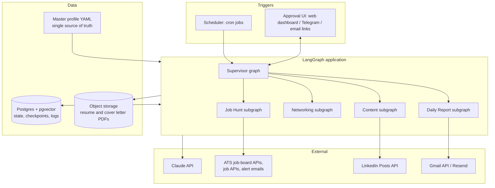

# Personal Agent: Project Plan

A LangGraph-based personal AI agent that (1) finds and prepares job applications with a tailored resume and cover letter for each job description, (2) builds a personal brand on LinkedIn (and later other platforms) with two genuine posts a week and targeted networking, and (3) emails a daily activity report.

Status: plan only, no code yet. Dates below are relative to kickoff.

---

## 1. Read this first: platform rules and account risk

The plan is shaped by one hard constraint, so it comes before the architecture.

**LinkedIn.** LinkedIn's User Agreement (section 8.2, "Don'ts") forbids using bots or other automated methods to access the service, add or download contacts, send or redirect messages, or scrape. LinkedIn actively detects browser automation and extensions that send connection requests or apply to jobs, and the usual outcome is a temporary restriction followed by a permanent ban. For a profile you are trying to build a reputation on, that is the worst possible outcome.

What LinkedIn does allow officially:

| Capability | Official route | Allowed for automation? |
|---|---|---|
| Publish posts on your own profile | Posts API via the self-serve "Share on LinkedIn" product (`w_member_social` scope, OAuth 2.0) | Yes |
| Sign in / read your basic profile | "Sign In with LinkedIn using OpenID Connect" | Yes |
| Send connection requests | No public API | No. Draft them, you send them |
| Apply to jobs / Easy Apply | No public API for candidates | No. Prepare the application, you submit |
| Read post analytics for a personal profile | Limited; Community Management API needs approval | Partially; fall back to manual entry or export |

**Job boards (LinkedIn Jobs, Naukri, Indeed, Glassdoor, Foundit, etc.).** All prohibit scraping and automated applications in their terms. Mass auto-apply also tends to hurt results: recruiters see identical low-fit applications and some ATSs flag repeat submissions.

**What the agent does instead (the compliant design):**

1. **Discovery** uses sources that allow programmatic access: public ATS job-board APIs (Greenhouse, Lever, Ashby, Workable, SmartRecruiters publish read-only JSON for each company's open roles), job APIs with clear terms (Adzuna, Remotive, RemoteOK, The Muse, Arbeitnow), company career pages you choose, and job-alert emails the platforms already send you (parsed from your inbox, which you are entitled to read).
2. **Preparation** is fully automated: match scoring, tailored resume, cover letter, answers to common screening questions.
3. **Submission** is human in the loop: the agent produces an "apply pack" (link, PDFs, pre-written answers) and you click submit. For Greenhouse/Lever/Ashby forms, an optional browser assistant can pre-fill fields on your own machine and stop before the submit button. It never submits on LinkedIn or Naukri.
4. **LinkedIn posts** go out through the official Posts API after you approve each draft.
5. **Connection requests** are researched and drafted by the agent (who, why, a personalised note), then delivered to you as a short daily list with profile links. Sending 5 to 10 a day by hand takes about five minutes.

This keeps roughly 90% of the labour automated while keeping your accounts safe. Section 10 lists what would change if you decide to accept more risk; the plan does not recommend it.

---

## 2. Goals and success metrics

| Area | Goal | Metric (weekly) |
|---|---|---|
| Job search | High-fit applications, not volume | 15 to 25 apply packs prepared; match score of 70+ for each; interview rate tracked |
| Resume quality | Tailored to each JD without inventing anything | 100% of claims traceable to the master profile (enforced by a fact-check node) |
| Personal brand | Consistent, genuine presence | 2 posts published; impressions, reactions, comments, follower growth |
| Networking | Relevant connections, not random ones | 30 to 50 suggestions drafted; acceptance rate above 40% |
| Reporting | You always know what happened | Daily email delivered at the configured time, every day |

---

## 3. Architecture

### 3.1 Overview



### 3.2 Why LangGraph

- **Durable state with checkpoints** (Postgres checkpointer): a run can pause at an approval step for hours and resume exactly where it stopped.
- **`interrupt()` for human-in-the-loop**: every outward action (submitting, posting) passes through an approval node.
- **Subgraphs** keep the four workflows independent and testable.
- **Cron and long-running runs** are first-class on LangGraph Platform, and easy to reproduce self-hosted.
- **LangSmith tracing** shows every LLM call, cost and failure, which matters for an agent acting in your name.

### 3.3 Shared state and data model

Postgres tables (simplified):

- `profile_facts`: atomic facts from your master profile (role, company, dates, achievement, metric, skill, evidence). Every generated claim must cite one.
- `jobs`: source, url, company, title, location, salary, raw JD, parsed requirements, embedding, match score, status (`new`, `shortlisted`, `pack_ready`, `applied`, `rejected`, `interview`, `offer`, `skipped`).
- `applications`: job id, resume version, cover letter, screening answers, approved_at, submitted_at, outcome.
- `posts`: pillar, draft, final text, media, scheduled_at, published_at, LinkedIn URN, metrics snapshots.
- `connection_suggestions`: name, headline, profile URL, reason, note draft, status (`suggested`, `sent`, `accepted`, `ignored`).
- `activity_log`: every action the agent took, with timestamp and run id. The daily report is built only from this table.

### 3.4 The subgraphs

**A. Job Hunt (runs 2 to 3 times a day)**

```
fetch_sources → normalize → dedupe → parse_jd → score_match ──(score < threshold)──> log_skip
                                                     │
                                                     ▼
                                    tailor_resume → write_cover_letter → answer_screening_qs
                                                     │
                                                     ▼
                                    fact_check (claims ⊆ profile_facts?) ──fail──> revise (max 2)
                                                     │
                                                     ▼
                                    render_pdfs → build_apply_pack → interrupt(approval) → mark_applied → log
```

- `score_match`: hybrid score combining embedding similarity (JD vs. profile), hard filters (location, visa, salary floor, seniority, blocked companies) and an LLM rubric that returns must-have coverage and gaps. Only jobs above the threshold (default 70/100) continue.
- `tailor_resume`: selects and reorders bullets from the master profile, mirrors the JD's terminology where it is truthful, and keeps a single-column ATS-friendly layout. It never adds a skill, title, employer or number that is not in `profile_facts`.
- `fact_check`: a separate, cheaper model call that maps each sentence to a fact id and fails the draft on any unsupported claim. This is the main guard against the agent inventing things in your name.
- `render_pdfs`: master profile (JSON Resume schema in YAML) → Jinja template → Typst (or LaTeX) → PDF. Typst is fast and easy to template.
- `interrupt(approval)`: you see the job, the match explanation and both documents, then choose approve, edit, or skip. Approve opens the application link with the pack ready (and, for Greenhouse/Lever/Ashby, optionally runs the local pre-fill assistant).

**B. Content (personal brand, 2 posts a week)**

```
weekly_plan (Sunday) → for each slot: ideate → research → draft → voice_check → fact_check
      → interrupt(approval, edit) → schedule → publish via Posts API → collect_metrics (+24h, +72h, +7d)
```

- Ideas come from content pillars (section 6), your recent work notes, the jobs you are targeting (what skills are in demand), and a short "what did you learn this week?" prompt the agent emails you.
- `voice_check` compares the draft to 5 to 10 of your past posts or writing samples and rejects generic AI-sounding phrasing ("In today's fast-paced world", emoji walls, hashtag stuffing).
- Default slots: Tuesday and Thursday mornings in your timezone. Adjust once metrics show your audience's best times.

**C. Networking (connection suggestions)**

```
gather_targets → enrich (public info you provide or that APIs return) → rank → draft_note (≤ 300 chars)
      → add to daily list → you send manually → you mark sent/accepted (one click in the dashboard)
```

- Targets, in priority order: recruiters and hiring managers at shortlisted companies, people who engaged with your posts, alumni of your college or past employers, speakers and attendees of events you attend, peers in your target role.
- Targets come from sources you supply (CSV exports, event attendee lists, people you note) and from the companies in the job pipeline. The agent does not crawl LinkedIn.
- Notes reference something specific (their post, a shared employer, a role they are hiring for). No templated "I'd love to connect".

**D. Daily Report (every evening)**

Reads `activity_log` for the last 24 hours and sends one email:

- Jobs discovered, shortlisted, skipped (with top reasons), apply packs waiting for you (with links)
- Applications marked submitted, status changes, any recruiter replies detected in your inbox
- Posts drafted, waiting for approval, published, and their metrics
- Connection suggestions for tomorrow (name, why, note, profile link)
- Errors or sources that failed
- A weekly summary on Sundays with trends

HTML email built from a Jinja template, sent with the Gmail API (from your own account) or Resend/SendGrid.

### 3.5 Model choice

| Task | Model | Why |
|---|---|---|
| JD parsing, match rubric, fact check | `claude-haiku-5-5` | High volume, structured output, cheap |
| Resume tailoring, cover letters, posts | `claude-sonnet-5-5` | Writing quality |
| Weekly content strategy, hard rewrites | `claude-opus-5-5` (optional) | Best reasoning, used sparingly |
| Embeddings for matching | Voyage AI or a local `sentence-transformers` model | Stored in pgvector |

Use structured outputs (Pydantic models) for every parsing and scoring step, and prompt caching for the master profile, which is sent on almost every call.

### 3.6 Approval interface

Start simple and grow:

1. **Phase 1**: approve via signed links in the daily email (approve / skip), edits through a small web page.
2. **Phase 2**: a FastAPI + HTMX (or Next.js) dashboard: pipeline board for jobs, post calendar, connection list, settings.
3. **Optional**: a Telegram bot for approvals on your phone.

---

## 4. Tech stack

| Layer | Choice |
|---|---|
| Language | Python 3.12, `uv` for dependencies |
| Agent framework | `langgraph`, `langchain-anthropic`, `langgraph-checkpoint-postgres` |
| API / dashboard | FastAPI, HTMX + Tailwind (or Next.js later) |
| Database | Postgres 16 + pgvector (Neon or Supabase free tier, or self-hosted) |
| Files | Cloudflare R2 or S3 for generated PDFs |
| Documents | Typst + Jinja templates; `python-docx` if a .docx is needed |
| Browser assist (optional, local only) | Playwright, pre-fill only, never submits |
| Email | Gmail API (OAuth) or Resend |
| Scheduling | LangGraph Platform crons, or APScheduler / system cron self-hosted |
| Observability | LangSmith tracing, Sentry for errors, structured logs |
| Secrets | `.env` locally; platform secret store or Doppler in production |
| CI | GitHub Actions: ruff, mypy, pytest, prompt evals on a fixed JD set |

---

## 5. Repository layout

```
personal-agent/
├── pyproject.toml
├── langgraph.json                 # graph entry points for LangGraph server/Platform
├── docker-compose.yml             # api + worker + postgres + (optional) redis
├── profile/
│   ├── master_profile.yaml        # your facts: experience, projects, skills, metrics
│   ├── preferences.yaml           # roles, locations, salary floor, blocklist, timezone
│   └── voice_samples/             # past posts and writing for voice matching
├── src/agent/
│   ├── state.py                   # TypedDict / Pydantic state schemas
│   ├── supervisor.py
│   ├── graphs/
│   │   ├── job_hunt.py
│   │   ├── content.py
│   │   ├── networking.py
│   │   └── daily_report.py
│   ├── nodes/                     # one module per node, pure functions where possible
│   ├── sources/                   # greenhouse.py, lever.py, ashby.py, adzuna.py, alert_emails.py ...
│   ├── integrations/              # linkedin_posts.py, gmail.py, storage.py
│   ├── documents/                 # resume + cover letter templates and renderer
│   ├── prompts/                   # versioned prompt files
│   └── db/                        # SQLAlchemy models, Alembic migrations
├── web/                           # FastAPI dashboard and approval endpoints
├── tools/prefill/                 # optional local Playwright pre-fill assistant
├── evals/                         # fixed JDs + expected properties, run in CI
└── tests/
```

---

## 6. Strategy

### 6.1 Job search strategy

- **Quality over volume.** 3 to 5 strong applications a day beats 50 weak ones. The threshold and daily cap live in `preferences.yaml`.
- **Target list first.** Keep a list of 30 to 50 companies you want; the agent watches their ATS boards directly, which is where roles appear first.
- **Pair every application with a person.** For each shortlisted job, the networking graph suggests the recruiter or hiring manager, so the application is followed by a short, specific note.
- **Close the loop.** The agent reads replies in your inbox (Gmail API, read-only label filter) to update statuses, and suggests a polite follow-up after 7 to 10 days of silence.
- **Learn from outcomes.** Weekly: which titles, sources and resume variants led to replies. Adjust targeting.

### 6.2 LinkedIn brand strategy

- **Positioning statement** (one sentence, written with you in week 1): who you help, with what, and the proof. Headline, About section and posts all support it.
- **Three or four content pillars**, for example:
  1. Lessons from your hands-on work (projects, bugs, decisions, numbers)
  2. Your field explained simply (concepts, tools, comparisons)
  3. Career journey and job-search learnings (honest, specific)
  4. Curated insight: a take on industry news, with your opinion
- **Formats rotation**: short story post, carousel (PDF document post), "3 things I learned", a code or architecture diagram, a question to the audience.
- **Two posts a week, genuine by construction**: every draft starts from something real you did or learned that week (the agent asks you each Sunday). The agent writes; you approve and edit. Nothing posts without approval.
- **Engagement is where reach comes from.** The agent cannot comment for you (same ToS issue), but the daily email lists 5 posts from people in your network worth a thoughtful comment, with a suggested angle. Spending 10 minutes a day there typically does more than the posts themselves.
- **Profile optimisation pass** in week 1: headline, About, Featured section, skills ordering, banner, all aligned with the target role.

### 6.3 Networking strategy

- 5 to 10 personalised requests a day, well under LinkedIn's weekly invitation limit, which protects the account and keeps acceptance rates high.
- Mix: 40% recruiters and hiring managers at target companies, 30% peers in the target role, 20% alumni and ex-colleagues, 10% people who engaged with your posts.
- Withdraw requests that are still pending after 3 weeks (a reminder appears in the report).
- After acceptance: a short thank-you, no pitch. The agent drafts it.

### 6.4 Other platforms (phase 5)

Reuse each LinkedIn post, adapted per platform, only through official APIs:

- **X**: X API v2 (posting needs a developer account; check the current tier's limits and price)
- **Medium / Hashnode / Dev.to**: official APIs for long-form versions of the best posts
- **GitHub**: keep your profile README in sync with the projects you post about

---

## 7. Deployment

### 7.1 Environments

| Environment | Purpose | Runs |
|---|---|---|
| Local | Development | `langgraph dev` + Docker Postgres; LangGraph Studio for debugging graphs |
| Staging (optional) | Dry runs | Same stack with `DRY_RUN=true`: nothing is posted or emailed except to you |
| Production | Real runs | One of the two options below |

### 7.2 Option A (recommended to start): self-hosted with Docker on a small VM

- One VM (Hetzner CX22, DigitalOcean, AWS Lightsail, or Railway/Fly.io containers), roughly $5 to $15 a month.
- `docker-compose.yml` services: `api` (FastAPI dashboard + approval endpoints), `agent` (LangGraph server running the graphs), `scheduler` (APScheduler that triggers graph runs), `postgres` (or managed Neon/Supabase).
- Caddy as reverse proxy with automatic HTTPS for the dashboard; dashboard behind login (single user, passkey or OAuth with your Google account).
- Nightly Postgres backups to R2/S3.
- Deploy via GitHub Actions: on push to `main`, build image → push to GHCR → SSH deploy (`docker compose pull && up -d`) → run Alembic migrations.

### 7.3 Option B: LangGraph Platform (LangSmith Deployment)

- Push the repo with `langgraph.json`; the platform hosts the graphs with a managed Postgres checkpointer, task queue and **cron jobs** built in.
- Good fit if you want zero ops. Check current pricing for the plan that includes deployments; the dashboard and PDF storage still need a small separate host (or Vercel).

### 7.4 Schedules (defaults, your timezone)

| Job | When |
|---|---|
| Job discovery + apply-pack preparation | 08:00, 13:00, 18:00 |
| Inbox scan for replies and job-alert emails | Every 2 hours |
| Weekly content plan + "what did you learn?" email | Sunday 10:00 |
| Post publishing | Tuesday and Thursday 09:00 (after approval) |
| Post metrics collection | Daily 07:00 |
| Daily report email | 20:00 |
| Weekly summary | Sunday 20:00 |

### 7.5 Security and privacy

- OAuth tokens (LinkedIn, Gmail) encrypted at rest; least-privilege scopes (`w_member_social` for posts, `gmail.send` and a read-only label filter for Gmail).
- LinkedIn access tokens expire (about 60 days); the agent warns you in the report a week before.
- Your resume data is personal data: private repo, no profile data in logs, LangSmith traces with PII masking or a self-hosted tracer.
- Kill switch: `AGENT_PAUSED=true` stops all outward actions immediately.
- Hard caps in config: max posts per week, max apply packs per day, max LLM spend per day.

### 7.6 Estimated monthly cost (rough, verify current prices)

| Item | Estimate |
|---|---|
| Claude API (mostly Haiku, Sonnet for writing, with prompt caching) | $10 to $30 |
| VM / containers | $5 to $15 |
| Postgres (Neon/Supabase free tier to start) | $0 to $25 |
| Email (Gmail API free; Resend free tier) | $0 |
| Job APIs (Adzuna, public ATS boards) | $0 on free tiers |
| LangSmith (developer tier) | $0 to $39 |
| **Total** | **about $15 to $110** |

---

## 8. Roadmap

| Phase | Weeks | Deliverables | Done when |
|---|---|---|---|
| 0. Foundations | 1 | Repo skeleton, Docker, Postgres, LangSmith, CI; `master_profile.yaml` and `preferences.yaml` filled in with you; positioning statement; profile optimisation checklist | `langgraph dev` runs an empty supervisor; CI green |
| 1. Job Hunt MVP | 2 to 3 | Greenhouse + Lever + Ashby + Adzuna sources; dedupe; match scoring; resume + cover letter generation with fact check; PDF rendering; approval via email links | 10 real apply packs you would actually send |
| 2. Daily report | 3 | Activity log, HTML email, Gmail API send | Report arrives every day for a week without gaps |
| 3. Content engine | 4 to 5 | Weekly plan, drafting, voice check, approval UI, LinkedIn Posts API publishing, metrics | Two approved posts published through the API |
| 4. Networking + dashboard | 6 to 7 | Connection suggestions and notes, FastAPI dashboard (pipeline board, calendar, settings), inbox reply detection | You use the dashboard daily instead of email links |
| 5. Hardening and expansion | 8+ | Evals in CI, cost caps, backups, optional Playwright pre-fill for ATS forms, X / Medium / Dev.to cross-posting, outcome analytics | Runs unattended for 2 weeks with only approvals from you |

---

## 9. Testing and evaluation

- **Unit tests** for every node with fake LLM responses; source adapters tested against recorded fixtures.
- **Graph tests**: run each subgraph end to end with an in-memory checkpointer and assert on state transitions, including interrupt and resume.
- **Prompt evals** (in `evals/`): 20 fixed job descriptions; checks that every resume claim maps to a fact, that must-have keywords are covered when truthful, that cover letters stay under 300 words and mention the company specifically, and that posts pass the voice and banned-phrase checks. Run in CI on prompt changes.
- **Dry-run mode** for a full week before turning on publishing.

---

## 10. Risks and mitigations

| Risk | Impact | Mitigation |
|---|---|---|
| LinkedIn restriction or ban from automation | Lose the profile you are building | No automation of connection requests, messages, comments or Easy Apply; posts only via official API |
| Job-board ToS violations | Account bans on Naukri, Indeed, etc. | Discovery from APIs, ATS boards and your own alert emails only; you submit |
| Agent invents experience in a resume | Reputational and ethical damage, failed background checks | Fact bank + separate fact-check node; any unsupported claim blocks the pack |
| Generic AI-sounding posts | Hurts the brand instead of building it | Voice samples, banned-phrase list, posts grounded in your weekly notes, mandatory approval |
| LLM cost runaway | Unexpected bill | Daily spend cap, Haiku for volume work, prompt caching |
| OAuth token expiry | Silent failure of posting or email | Expiry warnings in the report; health check endpoint |
| Source API changes | Missing jobs | Adapter per source with fixture tests; failures shown in the daily report |

**If you want more automation anyway:** the realistic next step is the local Playwright pre-fill assistant for ATS forms (Greenhouse, Lever, Ashby, Workday), which stops before submit. Fully automated LinkedIn connection requests or Easy Apply are possible technically but carry a real ban risk, and this plan does not include them.

---

## 11. Inputs needed from you

1. Your current resume (or LinkedIn PDF export) to build `master_profile.yaml`
2. Target roles, seniority, locations or remote, salary floor, visa constraints, companies to avoid
3. 10 to 30 dream companies (for the ATS watch list)
4. Timezone and the email address for the daily report
5. 5 to 10 past posts or writing samples for voice matching
6. Which platforms beyond LinkedIn matter to you, in order
7. Hosting preference: self-hosted VM (recommended) or LangGraph Platform
